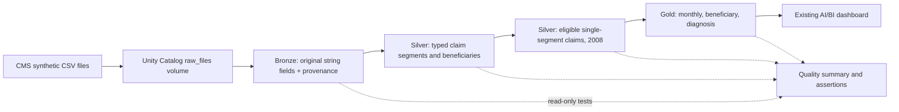

# ClaimsInsight — Synthetic Medicare Claims Analytics Lakehouse

ClaimsInsight turns synthetic inpatient claim records into a small, explainable analytics lakehouse on Databricks Free Edition. The business problem is to report claim volume, net payments, beneficiary concentration, and diagnosis patterns without double-counting claim segments or silently dropping adjustments.

This portfolio project uses historical **synthetic** Medicare records. Its totals are not actual Medicare expenditure measurements, savings estimates, or evidence of clinical outcomes.

## Data and architecture

Source: [CMS DE-SynPUF Sample 1](https://www.cms.gov/data-research/statistics-trends-and-reports/medicare-claims-synthetic-public-use-files/cms-2008-2010-data-entrepreneurs-synthetic-public-use-file-de-synpuf/de10-sample-1), specifically the 2008–2010 inpatient claims and 2008 beneficiary summary files. See the [CMS dataset overview and documentation](https://www.cms.gov/Research-Statistics-Data-and-Systems/Downloadable-Public-Use-Files/SynPUFs/DE_Syn_PUF.html) for limitations and data-use terms.



All tables are Delta tables in `workspace.claimsinsight`. Source CSV files are stored at `/Volumes/workspace/claimsinsight/raw_files/`. The existing dashboard, **ClaimsInsight — Synthetic Medicare Inpatient Claims 2008**, is unchanged.

| Layer/table | Grain |
| --- | --- |
| `bronze_inpatient` | Original inpatient source record, including segments |
| `bronze_beneficiary_2008` | Original 2008 beneficiary source record |
| `silver_inpatient_segments` | One row per `(claim_id, segment)` |
| `silver_inpatient_claims_2008` | One eligible single-segment claim with claim-through date in 2008 |
| `silver_beneficiaries_2008` | One 2008 beneficiary |
| `gold_monthly_claims_2008` | One claim-through month |
| `gold_beneficiary_spending_2008` | One beneficiary with eligible claims |
| `gold_diagnosis_spending_2008` | One first recorded diagnosis code, including `UNKNOWN` |

## Business questions

| Question | Gold model | Interpretation |
| --- | --- | --- |
| How do eligible claim volume and net payments vary by month? | Monthly claims | Month of `claim_through_date`, not payment date |
| Which beneficiaries account for the largest net claim payments? | Beneficiary spending | Count, net total, average, and largest claim per synthetic beneficiary |
| Which first recorded diagnosis codes are associated with the largest net payments? | Diagnosis spending | One diagnosis per claim; no causal attribution or clinical grouping |

## Verified MVP1 results

These user-provided reference values were independently checked against the live tables on November 15, 2026. [Detailed test evidence](docs/live_test_results.json) records each measured and expected value.

| Metric | Value |
| --- | ---: |
| Bronze inpatient records | 66,773 |
| Bronze 2008 beneficiaries | 116,352 |
| Distinct inpatient claim IDs across source years | 66,705 |
| Segment 1 / Segment 2 records | 66,705 / 68 |
| Claims with two segments | 68 |
| Repeated claim ID + segment combinations | 0 |
| Segment 2 records missing both service dates | 68 |
| Eligible 2008 reporting claims | 27,475 |
| Eligible claims with missing payment | 0 |
| Negative / zero / positive eligible payments | 22 / 1,039 / 26,414 |
| Eligible claims without matching beneficiaries | 0 |
| Net eligible claim payments | $254,560,980.00 |
| Beneficiaries with eligible claims | 15,740 |
| First-diagnosis categories, including unknown | 2,010 |

All three Gold tables reconcile to Silver by claim count and exact decimal payment total. Per-group comparisons also match, including rounded averages, distinct beneficiaries where applicable, and beneficiary maximum payments.

## Quality findings and decisions

- The 68 Segment 2 records all link to a Segment 1 record for the same beneficiary. Their missing dates are a documented source characteristic, not proof that they are independent invalid claims.
- Payments differ across some paired segments. Their financial meaning remains unresolved. Preserve every segment in Bronze and Silver, but exclude **the whole multi-segment claim** from MVP1 financial reporting.
- Retain negative and zero payments in signed net totals. Use `DECIMAL(18,2)` for Silver payments and the existing decimal aggregate types in Gold; do not use floating-point money comparisons.
- Parse source dates as `yyyyMMdd`; do not invent replacement service dates. Limit reporting by claim-through year.
- Use `ICD9_DGNS_CD_1` only. Normalize null/blank first-diagnosis values to `UNKNOWN` in Gold.
- The original Silver writer filters out null payments. The new tests compare against the unfiltered, otherwise-eligible cohort so future malformed payments cannot disappear unnoticed.

## Repository contents

```text
.github/workflows/ci.yml           Offline syntax and unit checks
README.md
DATA_QUALITY.md
docs/
  architecture.md
  data_dictionary.md
  engineering_decisions.md
  mvp_roadmap.md
  verification.md
  live_test_results.json           Actual live aggregate/schema results
  test_inventory.md               Every live test name and outcome
notebooks/
  01_Bronze_Ingestion.py
  02_Silver_Data_Profiling.py
  03_Silver_Transformation.py
  04_Gold_Analytics.sql
  05_Data_Quality_Tests.py
scripts/run_live_tests.py
tests/test_quality_runner.py
.gitignore
```

Notebooks 01–04 were exported from the existing workspace. Only explanatory cell comments were added; transformation statements were preserved. Gold exports as native SQL. Those notebooks contain overwrite/replace operations and were **not rerun** during Step 8.

## Run the tests

For the existing workspace, import **only** `notebooks/05_Data_Quality_Tests.py` as a Databricks notebook, attach available serverless compute, and Run All. It needs read access to the eight tables and their information-schema metadata. It displays PASS/FAIL, measured, and expected values, then raises an assertion if any check fails. It performs only `SELECT`/`WITH` queries and does not modify tables or the dashboard.

Alternatively, with the official Databricks CLI installed and a locally configured `claimsinsight` authentication profile:

```bash
python scripts/run_live_tests.py --profile claimsinsight --warehouse-id YOUR_WAREHOUSE_ID
```

The CLI route executes the **same SQL checks** through the Databricks SQL Statement Execution API. Authentication stays in your local CLI configuration; no credential belongs in this repository. The warehouse may start to execute these reads; use the existing Free Edition warehouse and its usage allowance.

Offline checks require only Python 3.11 or later:

```bash
python -m compileall -q notebooks scripts tests
python -m unittest discover -s tests -v
```

GitHub Actions runs these offline checks. It does **not** authenticate to Databricks or validate live tables. See [verification](docs/verification.md) for exactly what was executed.

## Reproduce MVP1 in a separate workspace

1. Create the `claimsinsight` schema under `workspace` and a `raw_files` Unity Catalog volume. Use a separate workspace for reproduction; the original notebooks hardcode these names.
2. Download the two Sample 1 files from CMS, extract the CSVs, and upload them to the volume using the exact filenames in notebook 01. Large CSVs are intentionally excluded from Git.
3. Import and run notebooks 01, 02, 03, and 04 in order. Review their write operations first. Notebook 02 is exploratory; it does not establish the reporting cohort.
4. Import notebook 05 and Run All. Investigate failures rather than changing data to meet reference numbers.
5. The existing dashboard is an external workspace artifact. Its definition is not exported here, and dashboard recreation is outside Step 8.

## Limitations and next steps

MVP1 covers a fixed synthetic Sample 1, 2008, single-segment inpatient cohort. It is a batch prototype, with no incremental ingestion, orchestration, deployment pipeline, or production monitoring. Schema contracts and reference counts intentionally detect changes in this fixed sample. Updates require review and a new documented baseline, not automatic expectation changes.

The future MVP2–MVP6 milestones are **proposals**, not implemented features: resolve segment semantics, introduce incremental processing, strengthen operational controls, add governed analytical dimensions, and evaluate deployment practices. See the [roadmap](docs/mvp_roadmap.md), [architecture](docs/architecture.md), [dictionary](docs/data_dictionary.md), and [engineering decisions](docs/engineering_decisions.md).
