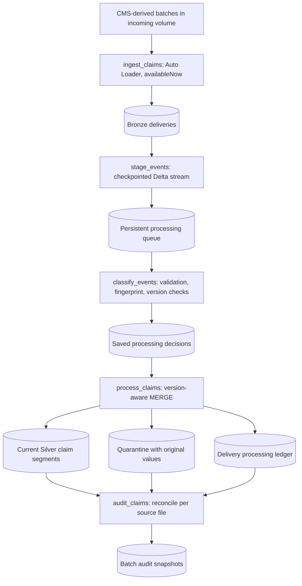

# ClaimsInsight MVP2 — CMS Real-Data Incremental Claims Pipeline

An incremental claims-processing pipeline on Databricks, using **CMS-derived synthetic Medicare inpatient records**. It ingests arriving CSV files, validates deliveries, applies newer claim versions, preserves rejected records, and reconciles outcomes through a five-task Lakeflow Job.

Insurance claims can arrive more than once or be corrected after initial submission. Reloading a full dataset cannot, by itself, distinguish a repeated event from a newer correction. MVP2 separates source deliveries, processing decisions, and current claim state so these cases remain traceable.

**“Real-data” refers to the published CMS DE-SynPUF dataset rather than a hand-authored event fixture. The records are synthetic, not actual patient claims.** The 2009/2010 batches, event IDs, versions, operations, and update timestamps are simulated from historical CMS data. This project does not measure actual Medicare spending or healthcare outcomes.

## Scope and stack

[MVP1](https://github.com/Shivani-exe/claimsinsight-databricks/tree/feature/mvp1-claims-analytics-lakehouse) established Bronze/Silver/Gold analytics and quality checks. This branch extends ingestion and claim-state processing at CMS sample scale; it does not replace the MVP1 dashboard or introduce new Gold models.

**Stack:** Databricks Free Edition · PySpark · SQL · Auto Loader · Delta Structured Streaming · Delta Lake MERGE · Unity Catalog · Lakeflow Jobs.

Source: [CMS DE-SynPUF Sample 1, 2008–2010 inpatient claims](https://www.cms.gov/data-research/statistics-trends-and-reports/medicare-claims-synthetic-public-use-files/cms-2008-2010-data-entrepreneurs-synthetic-public-use-file-de-synpuf/de10-sample-1). The original inpatient source has **66,773 rows**. This implementation selects 2009 and 2010 by **claim-start year**, unlike MVP1's claim-through-2008 reporting cohort.

## Five-task architecture



Job: **`ClaimsInsight_CMS_MVP2_Pipeline`**. Its task dependencies form a sequential chain with `max_concurrent_runs: 1`. The logical final task is `audit_claims`; the deployed task key is actually **`ausit_claims`**, preserved in the exported configuration.

Tables are isolated in `workspace.claimsinsight_cms_mvp2`. Generated files, schema tracking, and both checkpoints live under `/Volumes/workspace/claimsinsight/mvp2_cms_upgrade/`.

- Auto Loader appends CSV deliveries to Bronze and rescues schema drift into `_rescued_data`.
- A separate checkpoint tracks Bronze-to-queue progress. Both streams use `availableNow`: incremental batch execution, not a continuously running real-time service.
- Classification persists decisions by `(source_file, event_id)`. Payload fingerprints distinguish historical replays from conflicting event-ID reuse.
- Silver uses `(claim_id, segment)` as its business key and accepts newer `event_version` values. Rejections retain original queue values in quarantine.
- The ledger is registered after Silver/quarantine verification. Audits reconcile per-file outcomes and record a current Silver snapshot.

See [architecture](docs/architecture.md), [quality rules](docs/data_quality.md), and [engineering decisions](docs/engineering_decisions.md).

## Batch scenarios and verified results

Batch 001 contains **25,231** 2009 CMS-derived events. Batch 002 contains **13,572** 2010 events plus **100** repeated 2009 events, **10** payment corrections of +$100 each, **5** missing claim IDs, and **3** invalid payment strings: **13,690 deliveries**.

The following expectations were independently verified by read-only SQL on November 26, 2026 (America/Chicago). [Evidence includes the queries and measured results](evidence/live_verification.json).

| Final-state metric | Scenario expectation | Actual verified |
| --- | ---: | ---: |
| Bronze / queue deliveries | 38,921 each | 38,921 each |
| Saved decisions / ledger entries | 38,921 each | 38,921 each |
| Current Silver claim segments | 38,803 | 38,803 |
| Version-2 payment corrections | 10 | 10; each +$100 versus source |
| Ignored duplicate deliveries | 100 | 100 |
| Quarantined deliveries | 8 | 5 missing IDs + 3 invalid payments |
| Reconciled source-file audits | 2 | 2 |

Batch 001's audit records **25,231 merged, 0 rejected, 0 ignored**. Batch 002's audit records **13,582 merged, 8 quarantined, 100 ignored**. “Merged” counts approved deliveries, including corrections; it is not a count of newly inserted Silver rows. Current Silver has **38,803 unique claim-segment keys**, no missing payments, and a signed payment-state total of **$377,480,600.00**. This is a synthetic segment-state diagnostic, not a validated expenditure model.

The retrieved [Lakeflow run](https://dbc-66688edb-9ace.cloud.databricks.com/?o=7474656490632794#job/352752500046244/run/935354143644293) reports **SUCCESS for all five tasks**. [Run evidence](evidence/job_run.json) and [verification details](docs/verification.md) distinguish this observed execution from untested scenarios. No pipeline task was rerun during repository preparation.

## Repository layout

```text
notebooks/                         Five actual CMS job notebook exports, ordered 01–05
setup/00_CMS_Setup_and_Batches.py    Actual CMS batch-generation/setup notebook export
config/deployed_job.json            Retrieved visual Job settings
config/workspace_bundle/            Original workspace databricks.yml, kept separately
docs/                              Architecture, quality, decisions, verification, table contracts
evidence/                          Aggregate SQL results, task states, source-export hashes
scripts/check_repository.py         Offline syntax, links, configuration, and export-integrity checks
.gitignore                         Excludes data, checkpoints, local auth, and generated files
```

The five clean repository filenames map to the deployed `MVP2_16_...` through `MVP2_20_...` workspace notebooks in the [source manifest](evidence/source_manifest.json). Their logic was exported, not reconstructed or refactored.

## Execute or reproduce

For the existing workspace, inspect the [deployed Job snapshot](config/deployed_job.json), verify the intended files in `incoming/`, and run the existing job sequentially. Keep both checkpoints, saved decisions, and the ledger. Do not overwrite delivered files or reset checkpoints to simulate a normal rerun.

For a separate environment, review [setup prerequisites and execution order](docs/architecture.md) before importing the actual setup and five task notebooks. The setup export includes landing-file overwrites and staged, cell-by-cell steps; it is **not** a safe Run All command against the populated workspace. It also expects pre-existing template table structures, documented in [table contracts](docs/table_contracts.json).

The preserved [workspace bundle YAML](config/workspace_bundle/databricks.yml) names unnumbered notebooks that differ from the deployed paths. It is evidence of the saved configuration, **not a verified deployable copy** of the visual Job. Do not deploy it unchanged; reconcile notebook paths in your own environment first.

Run offline repository checks with Python 3.11 or later:

```bash
python scripts/check_repository.py
```

These checks do not connect to Databricks or execute Spark transformations.

## Retry safety and limits

Durable decisions, version checks, and insert-only delivery-key MERGEs support sequential retries. **Silver, quarantine, and ledger writes are separate transactions.** Checkpoints do not establish exactly-once business processing. Concurrent writers, a second scheduled rerun, and injected-failure recovery were not verified for this CMS job. Existing audits are insert-only snapshots, not repeated health checks of already-audited files.

The experiment verifies roughly 39,000 deliveries from one CMS sample. It makes no claim of production deployment, throughput benchmarks, general replay safety under every failure, or healthcare outcomes. Unexercised rule branches and other implementation limits are listed in [verification](docs/verification.md). Future MVPs remain separate work in this repository.
